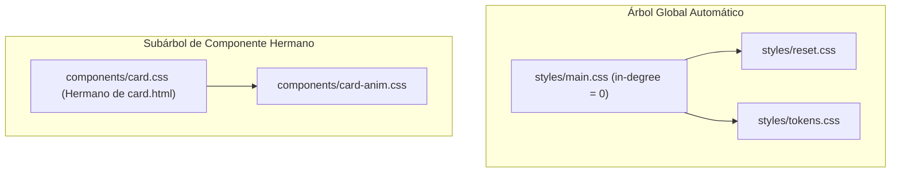

# Guía de Plantillas y Componentes en Bustatic

Bustatic utiliza HTML estándar complementado con etiquetas especiales de tiempo de compilación (`<layout>`, `<component>`, `<slot>`) y soporte nativo para **Web Components**.

---

## ⚡ Formas de Referenciar Rutas y Soporte en VS Code

Bustatic soporta tres formas flexibles de referenciar cualquier `<layout>`, `<component>` o `<each>`:

1. **Relativa a la Raíz del Proyecto (`/`):**
   ```html
   <layout src="/layouts/main.html">
     <component src="/components/card.html" />
     <each src="/data/features.json"> ... </each>
   </layout>
   ```
   *Ideal para rutas predecibles sin tener que contar cuántos `../` subir en páginas profundamente anidadas.*

2. **Relativa al Archivo Actual (`./` o `../`):**
   ```html
   <layout src="../layouts/main.html">
     <component src="../components/card.html" />
   </layout>
   ```
   *Ideal para componentes colocados junto a las páginas (`./autor.html`) y para habilitar la navegación instantánea `Ctrl + Click` y el autocompletado nativo en VS Code.*

3. **Por Convención de Nombre:**
   ```html
   <layout src="main.html">
     <component src="card.html" />
   </layout>
   ```
   *La opción más corta: Bustatic busca automáticamente en las carpetas `layouts/` y `components/`.*

---

## 🚀 Virtual File System (VFS) y Caché en Memoria

Bustatic incorpora un **Virtual File System (VFS)** en memoria:
- **Indexación instantánea:** Al iniciar, indexa la estructura del proyecto en RAM, evitando miles de llamadas repetitivas `statSync` o `existsSync` a disco.
- **Caché de contenido:** Las plantillas HTML y archivos JSON se leen del disco una sola vez y se reutilizan en memoria a través de todas las páginas y bucles `<each>`.
- **Invalidación reactiva:** Durante `bustatic dev`, el observador de archivos refresca en el VFS únicamente los archivos modificados en tiempo real.

---

## 1. Layouts (`<layout>` y `<slot>`)

Un layout es una estructura base HTML (habitualmente en `layouts/`) que envuelve las páginas para compartir `head`, encabezados, navegación y pie de página.

### Definición del Layout (`layouts/main.html`):
```html
<!doctype html>
<html lang="es">
<head>
  <meta charset="utf-8">
  <title><slot name="title">{{site.title}}</slot></title>
  <link rel="stylesheet" href="/styles/main.css">
  <slot name="head"></slot>
</head>
<body>
  <!-- Referencia relativa: ¡Ctrl + Click en VS Code abre el archivo! -->
  <component src="../components/header.html" />

  <!-- Punto de inserción del contenido principal -->
  <main>
    <slot></slot>
  </main>

  <component src="../components/footer.html" />
</body>
</html>
```

### Uso en una Página (`pages/index.html`):
```html
<!-- Referencia relativa: ¡Ctrl + Click en VS Code abre layouts/main.html! -->
<layout src="../layouts/main.html">
  <!-- Inyección en el slot con nombre "title" -->
  <span slot="title">Inicio - Bienvenido</span>

  <h1>Página de Inicio</h1>
  <p>Este contenido reemplaza al <slot></slot> por defecto del layout.</p>
</layout>
```

---

## 2. Componentes (`<component>`)

Los componentes son fragmentos HTML reutilizables. Puedes ubicarlos en `components/` o incluso colocarlos en la misma carpeta de una página.

### Definición del Componente (`components/card.html`):
```html
<div class="card">
  <h3>{{title}}</h3>
  <p>{{description}}</p>
  <div class="extra">
    <slot></slot>
  </div>
</div>
```

### Uso con Rutas Relativas y Props:
```html
<component 
  src="../components/card.html" 
  title="Ultra Rápido" 
  description="Construido con Bun sin librerías externas">
  <a href="/docs">Leer más</a>
</component>
```

> [!TIP]
> Bustatic soporta tanto rutas relativas explícitas (`../components/card.html`, `./boton.html`) como nombres convencionales (`card.html` o `card`), para que uses el estilo que más te guste.

---

## 3. Iteración con `<each>` y Auto-Spread de Props

La directiva `<each>` te permite iterar arrays desde un archivo JSON externo (`src`) o desde variables ya presentes en memoria (`in`).

### Iterar archivo JSON con Auto-Spread a `<component>`
Si el bloque contiene un `<component>`, las claves del objeto JSON se inyectan automáticamente como props del componente (equivalente a `{...props}` en JSX):

```html
<!-- Cero boilerplate: cada objeto inyecta sus claves automáticamente -->
<each src="../data/features.json">
  <component src="../components/card.html" />
</each>
```

### Iterar con alias explícito (`as="item"`):
```html
<each src="../data/features.json" as="item">
  <component src="../components/card.html" title="{{item.title}}" description="{{item.description}}" />
</each>
```

### Iterar colecciones en memoria y elementos HTML estándar:
```html
<nav>
  <each in="site.navLinks" as="link">
    <a href="{{link.url}}">{{link.label}}</a>
  </each>
</nav>
```

---

## 4. Renderizado Condicional y Atributos Opcionales

Para evitar dejar elementos vacíos en el DOM cuando un atributo opcional no viene en los datos:

### Opción A: Atributo condicional `if="..."` (en cualquier etiqueta)
Elimina **todo el elemento o subcomponente** si la variable no existe o es falsa/vacía:

```html
<!-- Si badge no viene en el JSON, todo el <span> desaparece sin dejar rastro -->
<span class="badge" if="badge">{{badge}}</span>

<!-- Funciona en subcomponentes enteros -->
<component src="./boton.html" if="url" href="{{url}}" />
```

### Opción B: Bloque condicional `<if is="...">` con `<else>`
Para bloques multilínea o bifurcaciones de lógica:

```html
<if is="isOnline">
  <span class="status online">En Línea</span>
  <else>
    <span class="status offline">Desconectado</span>
  </else>
</if>
```

### Opción C: Operador de Respaldo (`??`)
Para textos simples con valor por defecto cuando no necesitas borrar la etiqueta contenedora:

```html
<p class="author">Por: {{author ?? "Anónimo"}}</p>
```

---

## 5. Inyección de Datos JSON

Los archivos situados en la carpeta `data/` se cargan automáticamente:
- `data/site.json` crea la variable global `{{site.*}}`.

Ejemplo de `data/site.json`:
```json
{
  "title": "Mi Proyecto",
  "author": "María",
  "year": 2026
}
```

En cualquier plantilla o componente puedes interpolar valores directamente:
```html
<footer>
  <p>&copy; {{site.year}} {{site.title}} por {{site.author}}</p>
</footer>
```

---

## 6. Reactividad con Web Components Nativos y Auto-Importación

Para añadir interactividad del lado del cliente, Bustatic aprovecha la potencia de los **Web Components nativos** junto con el compilador integrado de Bun.

### Declaración en HTML (¡Sin etiquetas `<script>` manuales!)

Puedes declarar un Web Component de dos formas complementarias:

#### Opción A: Mediante la Etiqueta Estándar de HTML
Simplemente usa la etiqueta del componente en cualquier página o componente HTML:
```html
<!-- Bustatic detecta automáticamente la etiqueta e inyecta el script en <head> -->
<counter-button></counter-button>
```

#### Opción B: Mediante el Alias `<component src="...">` (¡Navegación Rápida en VS Code!)
Para una experiencia de desarrollo (DX) superior con **`Ctrl + Click`** en Visual Studio Code:
```html
<!-- Componente sin hijos / autocerrado -->
<component src="../components/counter-button.ts" id="contador" />

<!-- Componente con contenido proyectado en <slot> -->
<component src="../components/interactive-card.ts">
  <span slot="title">Panel Principal</span>
  <p>Contenido proyectado</p>
</component>
```

> [!TIP]
> **Diferenciación automática por extensión:**
> - `src="*.html"` &rarr; Componente estático renderizado en tiempo de compilación.
> - `src="*.ts"` o `*.js` &rarr; Web Component interactivo del lado del cliente.
> - Si la ruta del archivo no existe, Bustatic lanza una **excepción fatal inmediata** indicando el archivo faltante.

> [!NOTE]
> Ya no necesitas escribir `<script type="module" src="/components/counter.ts"></script>`. Bustatic inspecciona el árbol del proyecto, asocia la etiqueta con su archivo `.ts` o `.js` e inyecta la referencia automáticamente. Si ya habías escrito la etiqueta `<script>` manualmente, Bustatic la respeta sin duplicarla.

---

### Cómo declara y detecta Bustatic tus Web Components

Bustatic utiliza una doble estrategia de resolución indexada en su Virtual File System (VFS):

1. **Definición Explícita en Código (`customElements.define` o decoradores):**
   ```ts
   // components/counter.ts
   class CounterButton extends HTMLElement {
     count = 0;
     connectedCallback() {
       this.innerHTML = `<button>Clicks: ${this.count}</button>`;
       this.querySelector("button")?.addEventListener("click", () => {
         this.count++;
         this.querySelector("button")!.textContent = `Clicks: ${this.count}`;
       });
     }
   }

   customElements.define("counter-button", CounterButton);
   ```

### Regla Estricta 1:1: Nombre de Archivo = Etiqueta HTML

Para mantener una arquitectura predecible, modular y con resolución directa $O(1)$:
- **1 Web Component por archivo:** Cada archivo `.ts`/`.js` representa exactamente **un único Custom Element**.
- **Coincidencia unívoca de nombres:** El nombre del archivo debe coincidir de forma idéntica con la etiqueta en `kebab-case` o `PascalCase`:
  - `components/counter-button.ts` &rarr; `<counter-button>`
  - `components/CounterButton.ts` &rarr; `<counter-button>`
- Si un archivo define un tag que no coincide con su nombre o define más de uno, Bustatic emitirá una advertencia preventiva de validación y omitirá el registro conflictivo.

---

### Validación W3C y Prevención de Colisiones

Para garantizar código robusto tanto en desarrollo como en producción:
- **Especificación W3C:** Todas las etiquetas deben cumplir la especificación W3C (contener un guión `-`, iniciar con letra minúscula `[a-z]` y no coincidir con etiquetas reservadas del estándar como `font-face` o `annotation-xml`).
- **Detección de Colisiones:** Si dos archivos intentan definir la misma etiqueta (por ejemplo, `pkg-a/my-button.ts` y `pkg-b/my-button.ts`):
  - En **`bustatic dev`**: Emite una advertencia de colisión en consola y mantiene el registro sincronizado en caliente sin fugas de memoria si renombras o eliminas uno de los archivos.
  - En **`bustatic build`**: Lanza una excepción fatal antes del empaquetado indicando con exactitud los archivos en conflicto.
- **Aviso de Componentes No Registrados:** Si en tu HTML escribes una etiqueta Custom Element (ej. `<mi-componente>`) que no existe en el proyecto y no es una etiqueta reservada de W3C, Bustatic emite una advertencia preventiva `⚠ [Bustatic Warning]` en consola para detectar errores de escritura sin bloquear el uso de Custom Elements provenientes de CDNs externos.
- **Aviso de Componentes No Utilizados:** Durante `bustatic build`, si un Web Component está definido en el proyecto pero ninguna página HTML lo utiliza, Bustatic emite una advertencia en consola.

---

### La Tríada de Web Components con Declarative Shadow DOM

Bustatic implementa **Declarative Shadow DOM (DSD)** como el estándar 100% nativo para todos los Web Components. Esto te permite separar limpiamente tu lógica, estructura y estilos en tres archivos co-ubicados:

```
components/
├── counter-button.ts     # Solo lógica de negocio e interactividad
├── counter-button.html   # Estructura del DOM (soporta IDs limpios y <slot>)
└── counter-button.css    # Estilos nativos del Shadow DOM (:host, #btn)
```

#### 1. El archivo HTML (`components/counter-button.html`):
Usa HTML estándar limpio. Como el Shadow DOM garantiza aislamiento absoluto, **puedes usar atributos `id` con total seguridad** sin temor a colisiones con otros componentes de la página:

```html
<div class="counter-wrapper">
  <button type="button" id="btn">Clicks: 0</button>
  <slot></slot> <!-- Proyección de contenido que el usuario escriba en la página -->
</div>
```

#### 2. El archivo CSS (`components/counter-button.css`):
Usa selectores nativos de Shadow DOM. **No se agregan hashes ni clases artificiales (`.bs-xxxx`)**:

```css
:host {
  display: inline-block;
}

.counter-wrapper {
  display: inline-flex;
  align-items: center;
  gap: 1rem;
}

#btn {
  background-color: var(--accent);
  color: var(--bg-color, #0f172a);
  border: none;
  padding: 0.6rem 1.2rem;
  border-radius: 6px;
  font-weight: 600;
  cursor: pointer;
  transition: background-color 0.2s, transform 0.1s;
}

#btn:hover {
  background-color: var(--accent-hover);
}
```
*(Si usas el selector `&`, Bustatic lo mapea automáticamente a `:host`).*

#### 3. El archivo TypeScript (`components/counter-button.ts`):
Queda libre de cadenas HTML o CSS y no necesita invocar `attachShadow()` ni parsear `innerHTML`. Al ejecutarse, **`this.shadowRoot` ya fue creado nativamente por el navegador**:

```ts
class CounterButton extends HTMLElement {
  private count = 0;

  connectedCallback() {
    // ¡this.shadowRoot ya existe gracias al Declarative Shadow DOM!
    const shadow = this.shadowRoot!;
    const btn = shadow.getElementById("btn")!;
    btn.addEventListener("click", () => {
      this.count++;
      btn.textContent = `Clicks: ${this.count}`;
    });
  }
}

if (!customElements.get("counter-button")) {
  customElements.define("counter-button", CounterButton);
}
```

---

### Lo que genera Bustatic en el HTML estático:

Cuando escribes en tu página (`pages/index.html`):
```html
<counter-button>
  <span>Etiqueta del usuario</span>
</counter-button>
```

Bustatic emite en build time:
```html
<counter-button>
  <template shadowrootmode="open">
    <!-- Estilos globales para heredar tipografías y resets -->
    <style data-bustatic="global">...</style>

    <!-- Estilos aislados del componente -->
    <style>
      :host { display: inline-block; }
      #btn { ... }
    </style>

    <!-- Plantilla del componente -->
    <div class="counter-wrapper">
      <button type="button" id="btn">Clicks: 0</button>
      <slot></slot>
    </div>
  </template>

  <!-- El contenido del usuario se queda en el Light DOM y es proyectado al <slot> -->
  <span>Etiqueta del usuario</span>
</counter-button>
```

**Ventajas clave:**
- **Cero FOUC:** El botón ya aparece renderizado y estilizado en el milisegundo 0, antes de que el script JS termine de descargarse.
- **Proyección nativa de `<slot>`:** El texto `<span>Etiqueta del usuario</span>` se proyecta dentro del `<slot></slot>` manteniendo todos los estilos de la página exterior.
- **SEO Instantáneo:** Motores de búsqueda como Googlebot indexan el contenido de Declarative Shadow DOM de forma nativa.

---

### Anidación de Web Components (DSD Recursivo y Proyección de Slots)

Bustatic soporta completamente la anidación de Web Components en dos niveles:

#### 1. Anidación dentro de la Plantilla HTML Hermana (DSD Recursivo)
Un Web Component puede contener a otro Web Component directamente dentro de su archivo `.html` de la tríada. Por ejemplo:
- `components/interactive-card.html` contiene dentro a `<counter-button></counter-button>`.
- Al compilar, Bustatic detecta la dependencia de forma recursiva:
  - Genera el Declarative Shadow DOM anidado tanto para `<interactive-card>` como para `<counter-button>`.
  - Auto-importa automáticamente **ambos scripts** (`interactive-card.ts` y `counter-button.ts`) en el `<head>` de la página.
  - Bun agrupa, minifica y optimiza todos los scripts dependientes en un único chunk de producción sin código duplicado.

#### 2. Anidación vía Light DOM y Slots
Puedes anidar Web Components directamente en tus páginas proyectando contenido mediante slots nativos:
```html
<interactive-card>
  <span slot="title">Panel Principal</span>
  <p>Contenido proyectado en el slot por defecto.</p>
</interactive-card>
```
Bustatic distingue con precisión los slots destinados a los layouts globales de aquellos destinados a los Custom Elements aislados.


---

## 7. Estilos Scoped Nativos (`<style scoped>`)

Bustatic permite aislar estilos CSS directamente dentro de cualquier elemento HTML (en páginas, layouts o componentes) usando la etiqueta `<style scoped>`.

```html
<section class="interactive-box">
  <h2>Demostración</h2>
  <p>Texto estilado localmente...</p>
  <counter-button></counter-button>

  <style scoped>
    /* '&' hace referencia directa al elemento padre (<section>) */
    & {
      border: 1px dashed var(--accent);
      padding: 1.5rem;
    }

    /* Selectores descendientes aplicados únicamente dentro del contenedor */
    & > p {
      margin-bottom: 1rem;
      color: var(--text-muted);
    }

    p {
      line-height: 1.8;
    }

    &:hover {
      border-color: var(--accent-hover);
    }
  </style>
</section>
```

### ¿Cómo funciona la compilación?

1. **Detección del Contenedor:** Bustatic analiza el árbol HTML para identificar la etiqueta de apertura del elemento padre directo.
2. **Asignación de Clase Scoped:** Genera una clase única con prefijo `.bs-[hash]` y la añade al elemento padre (ej: `<section class="interactive-box bs-3usgx0c">`). Si el elemento no tenía atributo `class`, se crea automáticamente (`<p class="bs-3usgx0c">`).
3. **Transformación de Reglas CSS:**
   - **`&` (Selector Propio):** Se reemplaza por `.bs-[hash]` (ej. `& > p` $\rightarrow$ `.bs-3usgx0c > p`).
   - **`:host` (Alias):** Por compatibilidad con quienes vienen de Web Components y Shadow DOM, `:host` funciona como alias transparente de `&`.
   - **Hijos directos:** `> p` $\rightarrow$ `.bs-3usgx0c > p`.
   - **Descendientes:** `p` $\rightarrow$ `.bs-3usgx0c p`.
   - **Reglas compuestas:** `h1, h2` $\rightarrow$ `.bs-3usgx0c h1, .bs-3usgx0c h2`.
   - **At-Rules (`@media`):** Las reglas internas de un `@media` reciben automáticamente el prefijo de scope, mientras que reglas globales como `@keyframes` se preservan intactas.
4. **Limpieza del HTML:** La etiqueta `<style scoped>...</style>` se extrae completamente del cuerpo del HTML.

---

### Deduplicación Automática en Bucles (`<each>`) y Prevención de Colisiones

- **Deduplicación inteligente:** Cuando un componente con `<style scoped>` se multiplica en un bucle `<each>` o se reutiliza varias veces en la misma página, todas las instancias comparten la misma clase calculada a partir de su contenido CSS. El bloque CSS solo se emite **una sola vez**, evitando duplicaciones de código en el bundle final.
- **0% Riesgo de Colisión:** Un registro anticolisión en memoria compara el contenido real del CSS. Si dos bloques distintos llegaran a generar el mismo hash base, el compilador añade un sufijo incremental determinista (`-1`, `-2`), garantizando total aislamiento sin fugas de estilos.

---

### Estrategia de Estilos (`cssStrategy`)

Puedes configurar cómo se distribuye el CSS en `bustatic.config.ts`:

```ts
import { defineConfig } from "bustatic";

export default defineConfig({
  // "inline" (por defecto) o "external"
  cssStrategy: "inline",
});
```

- **`"inline"` (Por defecto):**
  - El CSS global (hojas de estilo locales `<link rel="stylesheet">`) y todos los estilos scoped se incrustan directamente en el `<head>` de cada página HTML.
  - **Ventajas:** Cero peticiones de red adicionales para CSS, First Contentful Paint (FCP) instantáneo y eliminación total del parpadeo de estilos (FOUC).
  - **Orden de Cascada:** El CSS global siempre se posiciona antes que el CSS scoped, permitiendo que las reglas del componente sobreescriban estilos base de manera natural.
- **`"external"`:**
  - El CSS global se mantiene como hoja de estilo externa compartida.
  - Cada página genera su propio archivo `.scoped.css` (ej. `/index.scoped.css`) enlazado mediante `<link rel="stylesheet">`.

---

### Archivos CSS Hermanos Co-ubicados (`.html` + `.css`)

Si prefieres separar por completo el HTML del CSS en lugar de escribir `<style scoped>` dentro del marcado, puedes crear un archivo `.css` con el mismo nombre y en el mismo directorio que tu componente o página HTML:

```
components/
├── footer.html
└── footer.css
```

#### Ejemplo de uso:

```html
<!-- components/footer.html -->
<footer class="site-footer">
  <p>&copy; 2026 Bustatic</p>
</footer>
```

```css
/* components/footer.css */
& {
  border-top: 1px solid var(--border);
  padding: 1.5rem;
  text-align: center;
}

& > p {
  color: var(--text-muted);
}
```

Bustatic detectará automáticamente el archivo `footer.css`, lo asociará al elemento raíz del componente (`<footer class="site-footer">`) y aplicará las mismas reglas de compilación, hashing y deduplicación que un bloque `<style scoped>`.

> [!IMPORTANT]
> **Requisito de Elemento Raíz Único:**
> Para aplicar estilos desde un archivo `.css` hermano, el archivo HTML debe tener **un único elemento contenedor raíz**. Si el HTML es un fragmento con múltiples elementos en el nivel superior (por ejemplo: `<h2>...</h2><p>...</p>`), los estilos **no se aplicarán** a ningún elemento y Bustatic mostrará una advertencia en consola para evitar ambigüedades.

---

### Jerarquía de Prioridades y Cascada de Estilos

Bustatic maneja la precedencia de estilos siguiendo de manera estricta el estándar de la cascada de CSS (*Source Order* y especificidad). 

Si un componente define estilos en un archivo hermano (`footer.css`) y **al mismo tiempo** incluye un bloque `<style scoped>` en su HTML, las prioridades se resuelven de forma predecible sin guerras de especificidad:

#### Orden de Precedencia (de menor a mayor prioridad):

```
┌─────────────────────────────────────────────────────────────┐
│ 1. CSS Global (styles/main.css)                             │  (Estilos base / reset / tipografía)
├─────────────────────────────────────────────────────────────┤
│ 2. Sibling CSS (components/footer.css)                      │  (Estilos base del componente)
├─────────────────────────────────────────────────────────────┤
│ 3. Bloque <style scoped> en el HTML                         │  (Sobrescritura local del componente)
├─────────────────────────────────────────────────────────────┤
│ 4. Atributo HTML inline: style="..."                        │  (Máxima especificidad CSS)
└─────────────────────────────────────────────────────────────┘
```

#### ¿Cómo se resuelve técnicamente?
1. El contenido del archivo CSS hermano se inyecta al inicio del elemento raíz antes del bloque `<style scoped>` interno.
2. El elemento HTML recibe ambas clases de scope (por ejemplo: `<footer class="site-footer bs-sibling bs-manual">`).
3. Ambas clases tienen la misma especificidad CSS (`0, 1, 0`).
4. Por las reglas de la cascada de CSS, **a igual especificidad, la regla declarada más abajo en la hoja de estilos tiene prioridad y gana**.
5. Por lo tanto, cualquier propiedad definida en el bloque `<style scoped>` explícito sobrescribirá limpiamente a la definida en el archivo `.css` hermano sin requerir `!important`.

---

## 8. Bosque de Grafos de Dependencias CSS y Raíz Global Automática

Bustatic no depende de nombres de archivo mágicos ni te obliga a escribir manualmente etiquetas `<link rel="stylesheet">` en tus layouts.

El compilador analiza todos los archivos `.css` del proyecto como un **Grafo Dirigido de Dependencias (DAG)**:



### 1. Detección de la Raíz Global Única
- Bustatic identifica todos los archivos `.css` que no tienen un hermano `.html` o `.ts`.
- Si un archivo CSS es importado por un componente hermano (ej. `components/card-anim.css` importado por `card.css`), queda **reclamado** por ese componente y no se confunde con CSS global.
- Entre los archivos huérfanos restantes, el compilador calcula el **grado de entrada (in-degree)**: cuántos otros archivos lo importan con `@import`.
- El archivo con `in-degree === 0` es la **raíz global única del proyecto**.

### 2. Auto-Inyección en todas las páginas
- **Cero etiquetas `<link>` manuales:** Si existe una raíz global (ej. `styles/main.css`), Bustatic la inyecta automáticamente en el `<head>` de todas tus páginas y dentro de los `<template shadowrootmode="open">` de tus Web Components.
- **Soporte de `cssStrategy`:**
  - En modo `"inline"` (por defecto): Se inyecta como `<style id="__bustatic_global">` directamente en el `<head>` (cero FOUC, cero peticiones HTTP adicionales).
  - En modo `"external"`: Se inyecta como `<link rel="stylesheet" href="/styles/main.css">`.

### 3. Modularización con `@import` y Aplanado Automático (Flattening)
Puedes dividir tus estilos globales o de componentes en tantos archivos como desees:
```css
/* styles/main.css */
@import "./reset.css";
@import "./tokens.css";
@import "./typography.css";

body {
  background-color: var(--bg-color);
}
```

Bustatic aplana los `@import` locales en tiempo de compilación en el orden topológico correcto, garantizando que el CSS final esté minificado, ordenado y sin sentencias `@import` que puedan provocar bloqueos o parpadeos en el navegador.

### 4. Detección Preventiva de Conflictos
Si tienes dos o más archivos CSS huérfanos que nadie importa (por ejemplo, `styles/site.css` y `styles/admin.css` sin que uno importe al otro), Bustatic detecta el conflicto y emite una advertencia clara en la consola para ayudarte a mantener un único origen de estilos globales o asignarlos a sus respectivas páginas como archivos hermanos.


